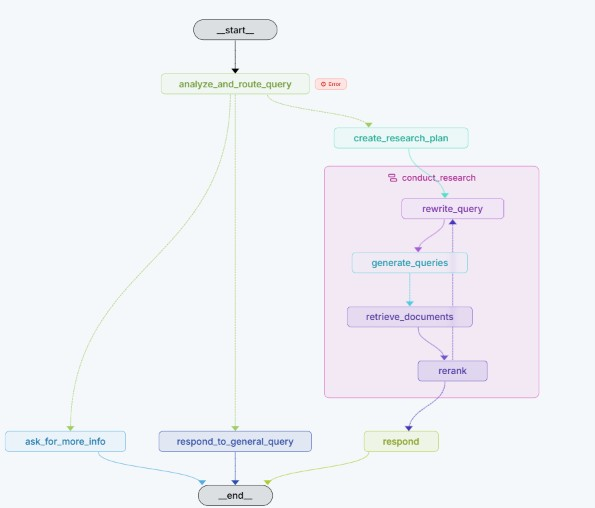
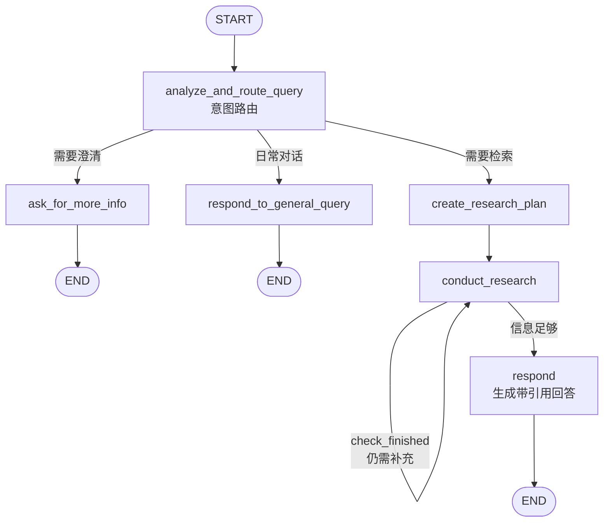
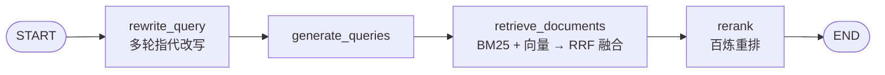
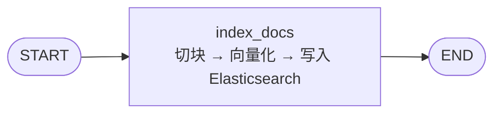

# RAG Research Agent

基于 **LangGraph** 的检索增强问答 Agent：意图路由 → 多步研究检索 → 混合检索（BM25 + 向量 + RRF）→ 重排 → 带引用生成。附带一套自建评测基座，用可复现的数字衡量每次改动的收益。



---

## 来源说明

本项目基于 [LangChain 官方 RAG Research Agent Template](https://github.com/langchain-ai/rag-research-agent-template)（MIT License, Copyright (c) 2024 LangChain）改造而来。

- 最初的图编排骨架（路由 → 研究子图 → 生成）来自该模板
- 检索层、重排、缓存、评测体系为在此基础上新增
- 原始版权归 LangChain 所有，`LICENSE` 文件保留未改动

---

## 相比上游模板做了什么

| 改造 | 主要位置 | 说明 |
|---|---|---|
| **混合检索** | `src/shared/hybrid.py` | 纯 Python 实现的 BM25 + 向量检索，用 RRF 融合，不需要额外检索服务。中文按相邻两字 bigram 切分，英文按词切分并小写 |
| **重排（Rerank）** | `src/shared/hybrid.py` | 阿里云百炼 rerank 客户端，候选数 / top-n / 超时均可配置 |
| **语义缓存** | `src/shared/cache.py` | 进程内语义缓存 + 命中统计，预留 Redis 后端 |
| **评测基座** | `eval/` | 自建测试集、LLM-as-judge、Bootstrap 显著性检验、embedding 磁盘缓存 |
| **多轮改写与拒答** | `src/retrieval_graph/` | 多轮指代改写；证据不足时明确拒答，而不是强行生成 |
| **模型与向量库可切换** | `src/shared/configuration.py` | 百炼（DashScope）模型 + 本地 Docker Elasticsearch |

---

## 架构

### 主图：对话式检索



### 研究子图：单轮检索



### 索引图



---

## 快速开始

### 1. 准备依赖

```powershell
uv sync
uv add --dev "langgraph-cli[inmem]"
```

### 2. 配置环境变量

```powershell
Copy-Item .env.example .env
```

然后编辑 `.env`，填入真实密钥：

| 变量 | 说明 |
|---|---|
| `DASHSCOPE_API_KEY` | 阿里云百炼 API Key，[控制台](https://bailian.console.aliyun.com/) 获取 |
| `DASHSCOPE_BASE_URL` | 百炼 OpenAI 兼容接口地址 |
| `ELASTICSEARCH_URL` | 本地 Elasticsearch 地址，须用 `127.0.0.1` |
| `ELASTICSEARCH_USER` / `ELASTICSEARCH_PASSWORD` | ES 凭据 |

> `.env` 已在 `.gitignore` 中，不会被提交。

### 3. 启动向量库

```powershell
docker run -d --name elasticsearch -p 9200:9200 `
  -e "discovery.type=single-node" `
  -e "ELASTIC_PASSWORD=changeme" `
  docker.elastic.co/elasticsearch/elasticsearch:8.15.0
```

### 4. 启动 LangGraph Studio

```powershell
.\start-studio.bat
```

或手动：

```powershell
.venv\Scripts\langgraph.exe dev --port 2024 --allow-blocking
```

浏览器打开 https://smith.langchain.com/studio/?baseUrl=http://127.0.0.1:2024

---

## 评测

`eval/` 是一套独立的离线评测基座，不依赖 LangSmith 或 ragas：

| 文件 | 作用 |
|---|---|
| `run_eval.py` | 一条命令跑完整评测，输出人读的 `.md` 与机读的 `.json` 报告 |
| `judge.py` | 自实现的 LLM-as-judge，三个生成侧指标 |
| `metrics.py` | 检索层指标，纯函数实现、零网络依赖 |
| `stats.py` | Bootstrap 显著性检验，把"方向"升级成"可信" |
| `embed_cache.py` | embedding 磁盘缓存，重复评测几乎零成本 |
| `make_synthetic_cases.py` | 从语料自动生成合成测试集 |
| `testcases.yaml` | 60 条人工标注测试集 |

运行：

```powershell
python eval/run_eval.py
```

报告输出到 `eval/reports/`。

> **关于诚实**：其中"查询改写 + 拒答"这一项，实测提升为 **0**。这个结果如实记录，没有为了好看而调整口径——评测基座的价值恰恰在于它能推翻自己的假设。

---

## 项目结构

```
src/
├── index_graph/            索引图：文档切块、向量化、写入 ES
├── retrieval_graph/        主图：路由 + 研究循环 + 回答生成
│   └── researcher_graph/   研究子图：改写 → 生成查询 → 检索 → 重排
└── shared/
    ├── configuration.py    全局可配置项
    ├── retrieval.py        各类检索器装配
    ├── hybrid.py           BM25 + RRF 融合 + rerank 客户端
    ├── cache.py            语义缓存
    └── utils.py            通用工具
eval/                       离线评测基座
tests/                      单元测试与集成测试
```

---

## 配置项

关键可调参数（见 `src/shared/configuration.py`）：

| 参数 | 说明 |
|---|---|
| `embedding_model` | 向量模型 |
| `retriever_provider` | 检索器提供方（Elasticsearch / 内存） |
| `search_kwargs` | 检索参数（top-k 等） |
| `rerank_enabled` | 是否启用重排 |
| `rerank_model` | 重排模型 |
| `rerank_candidates` | 送入重排的候选数 |
| `rerank_top_n` | 重排后保留条数 |
| `rerank_timeout_s` | 重排请求超时 |

---

## License

MIT。原始模板版权归 **LangChain** 所有，详见 [LICENSE](./LICENSE)。
